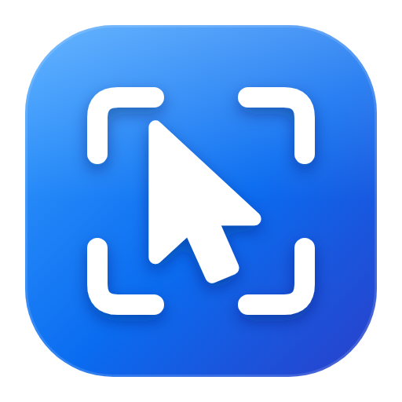
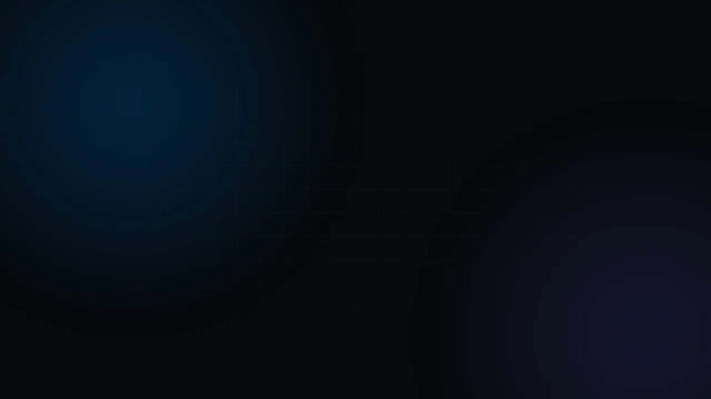

<p align="center">
  
</p>

<h1 align="center">DirectZoom</h1>

<p align="center">
  Screen recorder and editor for Windows. Record your screen, then turn it into a polished video<br>
  with zooms that follow your cursor, a smooth cursor, captions, voiceover and more.
</p>

<p align="center">
  <a href="https://github.com/MrFr0g-X/DirectZoom/releases/latest"></a>
  <a href="https://github.com/MrFr0g-X/DirectZoom/releases"></a>
  <a href="https://github.com/MrFr0g-X/DirectZoom/actions/workflows/ci.yml"></a>
  
  <a href="LICENSE"></a>
</p>

<p align="center">
  <a href="https://github.com/MrFr0g-X/DirectZoom/releases/latest"><b>Download</b></a> ·
  <a href="https://hothifa.is-a.dev/DirectZoom/">Website</a> ·
  <a href="https://hothifa.is-a.dev/DirectZoom/privacy.html">Privacy</a>
</p>

<p align="center">
  <br>
  <sub><a href="media/demo.mp4">Watch in 1080p</a></sub>
</p>

Record a display, a window or an area of your screen. DirectZoom keeps the cursor separate from the video, so you can restyle or smooth it afterwards, and it adds zooms where you clicked.

## Download

Get the latest version from [Releases](https://github.com/MrFr0g-X/DirectZoom/releases/latest):

- **Setup**: installs for your Windows user and keeps itself up to date.
- **Portable**: runs without installing.

Windows may show a SmartScreen notice for new apps. Choose **More info → Run anyway**.

## Features

- Screen, window or area recording with system audio, microphone and webcam
- Automatic zooms that follow your clicks, editable on the timeline
- Cursor styles, smoothing and click effects
- Backgrounds, rounded corners, shadows, crop and aspect ratios
- Multi-track timeline: split, trim, reorder, change speed, and edit camera and audio tracks separately
- Captions, voiceover, background music and speech cleanup
- Annotations, blur, webcam bubble, keyboard-shortcut overlay and 3D tilt
- Export to MP4, WebM or GIF up to 4K at 60 fps, with optional Google Drive upload
- Light and dark mode

Online captions and voiceover use your own ElevenLabs API key. They can also run fully offline.

## Requirements

Windows 10 (version 2004 or later) or Windows 11, 64-bit.

## Building from source

Requires Node.js 24 and Rust.

```powershell
npm install
npm run native
npm run desktop
```

Google Drive upload in your own build needs a Google OAuth client ("Desktop app"), added under Settings → Google Drive.

## Privacy

Your recordings and settings stay on your computer. Data is only sent when you use an online feature, such as ElevenLabs captions or a Google Drive upload. See the [privacy policy](https://hothifa.is-a.dev/DirectZoom/privacy.html) and [terms](https://hothifa.is-a.dev/DirectZoom/terms.html).

## Contact

[h@hothifa.tech](mailto:h@hothifa.tech)

## License

[MIT](LICENSE). Bundled third-party components keep their own licenses ([notices](THIRD-PARTY-NOTICES.md)).
